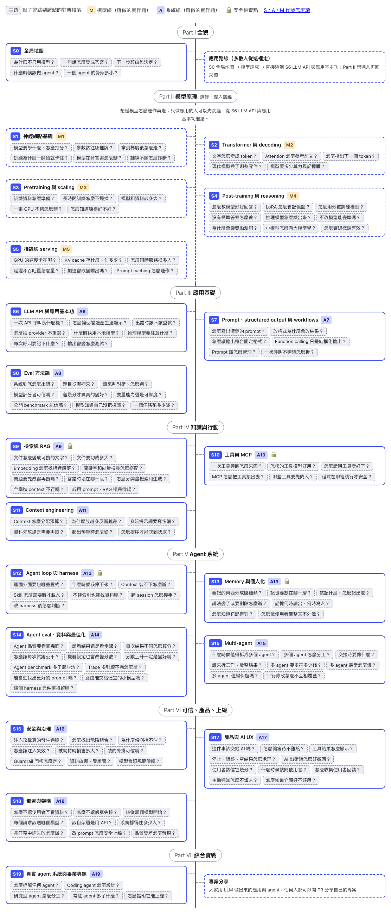

# Token2Agent

The AI/LLM roadmap, from tokens to agents.

[繁體中文](README.md) · **English**

Token2Agent is a free learning roadmap for AI/LLM engineering, written in Traditional Chinese (Taiwan). It starts from how text becomes tokens and ends with agent systems you can evaluate, secure and ship. Each chapter has a complete lecture, so you can learn from the site alone and follow the further reading when you want more.

Read it at **[token2agent.com](https://token2agent.com)**.

## Roadmap

<a href="https://token2agent.com">
<picture>
<source media="(prefers-color-scheme: dark)" srcset=".github/assets/roadmap-dark.png">

</picture>
</a>

The diagram is in Traditional Chinese. Click it for the interactive version on the site, where every chapter and topic links to its lecture.

| Part | Chapters |
|---|---|
| Part I The big picture | [S0 The big picture](https://token2agent.com/stages/s00-big-picture/) |
| Part II Model internals (optional) | [S1 Neural network basics](https://token2agent.com/stages/s01-neural-networks/) [S2 Transformer and decoding](https://token2agent.com/stages/s02-transformer/) [S3 Pretraining and scaling](https://token2agent.com/stages/s03-pretraining/) [S4 Post-training and reasoning](https://token2agent.com/stages/s04-post-training/) [S5 Inference and serving](https://token2agent.com/stages/s05-inference/) |
| Part III Application basics | [S6 LLM APIs and application basics](https://token2agent.com/stages/s06-llm-api/) [S7 Prompts, structured output and workflows](https://token2agent.com/stages/s07-prompting/) [S8 Eval methodology](https://token2agent.com/stages/s08-evals/) |
| Part IV Knowledge and actions | [S9 Retrieval and RAG](https://token2agent.com/stages/s09-rag/) [S10 Tools and MCP](https://token2agent.com/stages/s10-tools-mcp/) [S11 Context engineering](https://token2agent.com/stages/s11-context-engineering/) |
| Part V Agent systems | [S12 Agent loop and harness](https://token2agent.com/stages/s12-agent-harness/) [S13 Memory and personalization](https://token2agent.com/stages/s13-memory/) [S14 Agent evals, data and optimization](https://token2agent.com/stages/s14-agent-evals/) [S15 Multi-agent](https://token2agent.com/stages/s15-multi-agent/) |
| Part VI Trust, product, deployment | [S16 Security and governance](https://token2agent.com/stages/s16-security/) [S17 Product and AI UX](https://token2agent.com/stages/s17-ai-ux/) [S18 Deployment and architecture](https://token2agent.com/stages/s18-deployment/) |
| Part VII Capstone | [S19 Real agent systems and capstone](https://token2agent.com/stages/s19-capstone/) |

## What's inside

- **20 chapters** in seven parts: the big picture, model internals (optional), application basics, knowledge and actions, agent systems, trust/product/deployment, and capstone.
- **Three routes**: the application route for most readers (no machine-learning background needed), the full route with model internals, and an understanding-only route with no programming.
- **Two reading depths** on every page: 淺顯 (plain) shows the main line; 深入 (deep) opens derivations, implementation details, optional topics and advanced exercises.
- **Exercises as specs**: goal, steps and numeric acceptance criteria, never solutions. Two hands-on threads build up over the chapters: the system thread (A6–A19, your own AI application) and the model thread (M1–M5, training small models).
- **Built from 300+ sources**: 24 university courses (Stanford, CMU, Berkeley, National Taiwan University and more), engineering guides from Anthropic, OpenAI and Google, key papers, and Traditional and Simplified Chinese community material. The lectures explain them in their own words; every source is dated in the [source list](https://token2agent.com/reference/sources/).
- **Self-checks with hints**, a glossary and a concept index.
- **Project showcase**: anyone can share an AI app or agent they built.

## Why

There are many excellent resources for learning AI/LLM engineering, but they are spread across courses, papers and vendor docs with different vocabulary and depth, so beginners struggle to know where to start and in what order. Token2Agent turns them into one connected path: each concept is explained from the ground up, one running example (a notes assistant) threads through the application chapters, with worked numbers, common misconceptions and checkable exercises. When you want more, the further reading takes you back to the original sources.

## Getting started

Not sure where to begin? Read [how to use this roadmap](https://token2agent.com/guide/how-to-use/) and pick a route:

- **Application route** (recommended for most readers): build AI applications and agents. Start with [S0 The big picture](https://token2agent.com/stages/s00-big-picture/), read the [model crash course](https://token2agent.com/guide/app-first/), then go from S6 LLM APIs and application basics to S19 Real agent systems and capstone. About 175 hours.
- **Full route**: also learn how models work inside, S0 to S19 in order. About 225 hours.
- **Understanding route**: understand how AI systems work without programming. About 45 hours.

## Contributing

- **Share your project**: built an AI app or agent? Add it to the [showcase](https://token2agent.com/showcase/) with one pull request. You don't need to have followed the roadmap.
- **Report and fix**: found an error, outdated content or a broken link? Open an issue or a pull request.

Setup, authoring rules and the submission steps are in [CONTRIBUTING.md](CONTRIBUTING.md) (Traditional Chinese).

## License

- **Content** (everything under `src/content/docs/`) is released under [CC BY-NC-SA 4.0](https://creativecommons.org/licenses/by-nc-sa/4.0/); see [LICENSE-content](LICENSE-content). Contributions to the content are released under the same license.
- **Code** (the site's source outside `src/content/docs/` and `src/data/showcase/`) is released under the [MIT License](LICENSE).
- **Showcase entries** (`src/data/showcase/`) are submitted by their authors, who grant this site the right to display them; each project keeps its own license.
- Third-party material quoted or referenced on the site belongs to its respective owners.

The name "Token2Agent" refers to this project and must not be used to name a fork; "based on Token2Agent" is fine.
