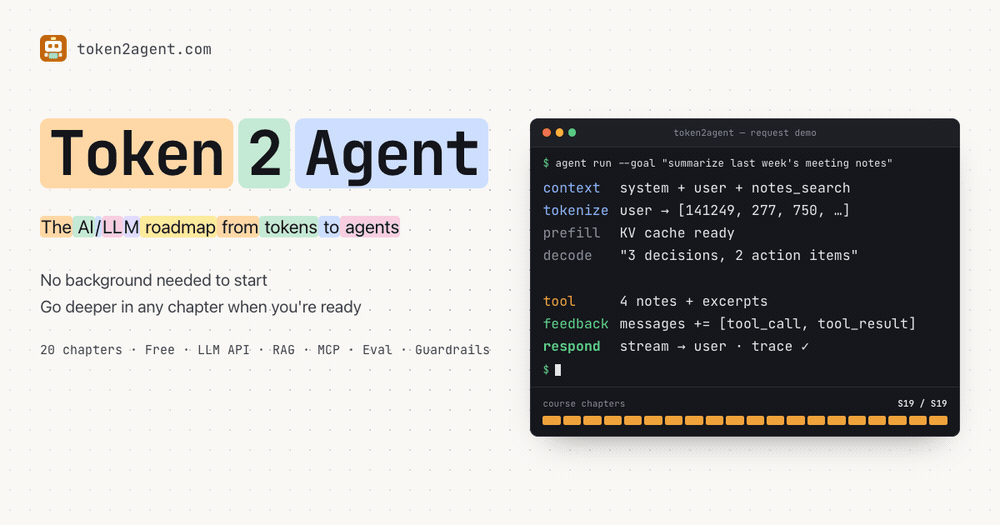
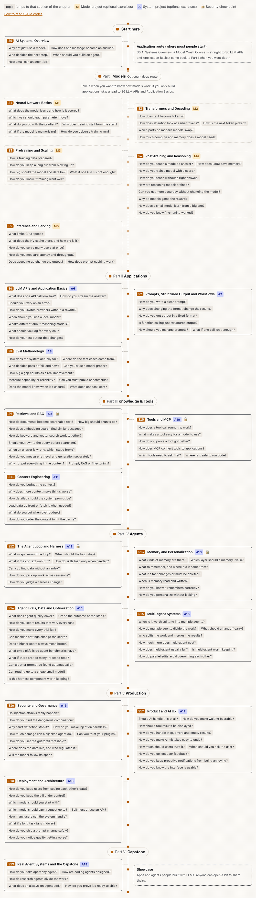

# Token2Agent

The AI/LLM roadmap, from tokens to agents.

[繁體中文](README.md) · **English**

Token2Agent is a free learning roadmap for AI/LLM engineering, in English and Traditional Chinese. It starts from how text becomes tokens and ends with agent systems you can evaluate, secure and ship. Each chapter has a complete lecture, so you can learn from the site alone and explore the recommended reading when you want more.

Read it at **[token2agent.com/en](https://token2agent.com/en/)**.

<a href="https://token2agent.com/en/">
<picture>
<source media="(prefers-color-scheme: dark)" srcset=".github/assets/hero-ids-fast-en-dark.gif">

</picture>
</a>

## Roadmap

<a href="https://token2agent.com/en/">
<picture>
<source media="(prefers-color-scheme: dark)" srcset=".github/assets/roadmap-en-dark.gif">

</picture>
</a>

Click the diagram for the interactive roadmap, where every chapter and topic links to its lecture.

| Part | Chapters |
|---|---|
| Start here | [S0 AI Systems Overview](https://token2agent.com/en/stages/s00-big-picture/) |
| Part I Models (optional) | [S1 Neural Network Basics](https://token2agent.com/en/stages/s01-neural-networks/) [S2 Transformers and Decoding](https://token2agent.com/en/stages/s02-transformer/) [S3 Pretraining and Scaling](https://token2agent.com/en/stages/s03-pretraining/) [S4 Post-training and Reasoning](https://token2agent.com/en/stages/s04-post-training/) [S5 Inference and Serving](https://token2agent.com/en/stages/s05-inference/) |
| Part II Applications | [S6 LLM APIs and Application Basics](https://token2agent.com/en/stages/s06-llm-api/) [S7 Prompts, Structured Output and Workflows](https://token2agent.com/en/stages/s07-prompting/) [S8 Evals Methodology](https://token2agent.com/en/stages/s08-evals/) |
| Part III Knowledge & Tools | [S9 Retrieval and RAG](https://token2agent.com/en/stages/s09-rag/) [S10 Tools and MCP](https://token2agent.com/en/stages/s10-tools-mcp/) [S11 Context Engineering](https://token2agent.com/en/stages/s11-context-engineering/) |
| Part IV Agents | [S12 The Agent Loop and Harness](https://token2agent.com/en/stages/s12-agent-harness/) [S13 Memory and Personalization](https://token2agent.com/en/stages/s13-memory/) [S14 Agent Evals, Data and Optimization](https://token2agent.com/en/stages/s14-agent-evals/) [S15 Multi-agent Systems](https://token2agent.com/en/stages/s15-multi-agent/) |
| Part V Production | [S16 Security and Governance](https://token2agent.com/en/stages/s16-security/) [S17 Product and AI UX](https://token2agent.com/en/stages/s17-ai-ux/) [S18 Deployment and Architecture](https://token2agent.com/en/stages/s18-deployment/) |
| Part VI Capstone | [S19 Real Agent Systems and the Capstone](https://token2agent.com/en/stages/s19-capstone/) |

## What's inside

- **20 chapters** with an introduction and six parts: models (optional), applications, knowledge and tools, agents, production, and the capstone.
- **Three routes**: the application route for most readers (no machine-learning background needed), the full route that includes how models work, and a concepts route with no programming.
- **Two reading modes** on every page: Simple shows the main line; Deep opens derivations, implementation details, optional topics and advanced exercises.
- **Exercises as specs**: goal, steps and numeric acceptance criteria, never solutions. Two hands-on projects build up over the chapters: the system project (A6–A19, your own AI application) and the model project (M1–M5, training small models).
- **Built from 300+ sources**: 24 university courses (Stanford, CMU, Berkeley, National Taiwan University and more), engineering guides from Anthropic, OpenAI and Google, key papers, and Chinese-language community material. The lectures explain them in their own words; every source is dated in the [source list](https://token2agent.com/en/reference/sources/).
- **Self-checks with hints**, a glossary and a concept index.
- **Project showcase**: anyone can share an AI app or agent they built.

## Why

There are many excellent resources for learning AI/LLM engineering, but they are spread across courses, papers and vendor docs with different vocabulary and depth, so beginners struggle to know where to start and in what order. Token2Agent turns them into one connected path: each concept is explained from the ground up, one running example (a notes assistant) threads through the application chapters, with worked examples, common misconceptions and checkable exercises. When you want more, the further reading takes you back to the original sources.

## Getting started

Not sure where to begin? Read [how to use this roadmap](https://token2agent.com/en/guide/how-to-use/) and pick a route:

- **Application route** (recommended for most readers): build AI applications and agents. Start with [S0 AI Systems Overview](https://token2agent.com/en/stages/s00-big-picture/), read the [Model Crash Course](https://token2agent.com/en/guide/app-first/), then go from S6 LLM APIs and Application Basics to S19 Real Agent Systems and the Capstone.
- **Full route**: also learn how models work inside, S0 to S19 in order.
- **Concepts route**: understand how AI systems work without programming.

## Contributing

- **Share your project**: built an AI app or agent? Add it to the [showcase](https://token2agent.com/en/showcase/) with one pull request. You don't need to have followed the roadmap.
- **Report and fix**: found an error, outdated content or a broken link? Open an issue or a pull request.

Setup, authoring rules and the submission steps are in [CONTRIBUTING.md](CONTRIBUTING.md) (Traditional Chinese).

## License

- **Content** (everything under `src/content/docs/`) is released under [CC BY-NC-SA 4.0](https://creativecommons.org/licenses/by-nc-sa/4.0/); see [LICENSE](LICENSE). Contributions to the content are released under the same license.
  - **Additional permissions**: with credit and a link back to the original page, the following are allowed even when commercial: quoting in articles, blogs, newsletters, talks and videos (including ad-supported or monetized ones); study or internal training inside a company or organization, as long as no one is charged for it; assigning the site as reading in any course, free or paid, by linking to it; search engines and AI tools retrieving and quoting the content to answer questions.
  - **Still needs permission**: selling the content or adaptations of it (paid courses, books, e-books, paywalled sites, products built mainly on it). Open an issue to ask.
- **Code** (the site's source outside `src/content/docs/` and `src/data/showcase/`) is released under the [MIT License](LICENSE-code).
- **Showcase entries** (`src/data/showcase/`) are submitted by their authors, who grant this site the right to display them; each project keeps its own license.
- Third-party material quoted or referenced on the site belongs to its respective owners.

The name "Token2Agent" refers to this project and must not be used to name a fork; "based on Token2Agent" is fine.
